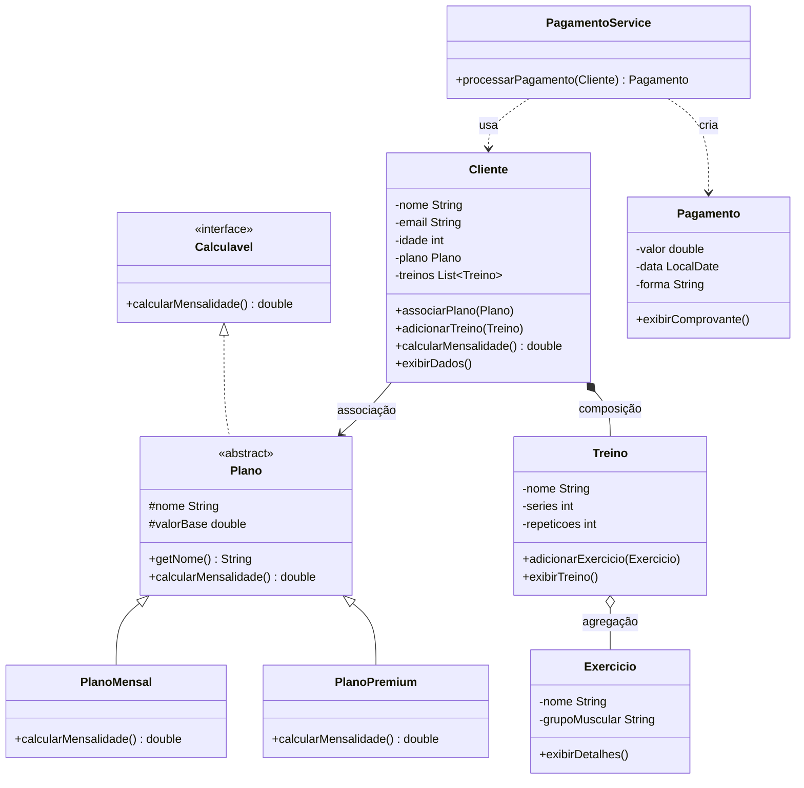

# FitLife — Sistema de Gestão de Academia

Atividade Prática (Aula 15 – Unidade 4) da disciplina **Programação Orientada a Objetos** — Anhanguera.

Módulo funcional do sistema da academia FitLife: clientes, planos, treinos e pagamentos, com validação de dados, tratamento de exceções e testes automatizados.

## Requisitos funcionais atendidos

| # | Requisito | Onde |
|---|-----------|------|
| 1 | Cadastrar clientes (nome, e-mail, idade) | `Cliente` |
| 2 | Cadastrar planos (Mensal e Premium) | `PlanoMensal`, `PlanoPremium` |
| 3 | Associar plano a um cliente | `Cliente.associarPlano()` |
| 4 | Cadastrar treinos para o cliente | `Treino`, `Cliente.adicionarTreino()` |
| 5 | Processar pagamento da mensalidade | `PagamentoService` |
| 6 | Validar dados e tratar exceções | `Cliente`, `Plano`, `Treino`, `TreinoInvalidoException` |
| 7 | Exibir informações no console | `Main`, `exibirDados()`, `exibirComprovante()` |

## Conceitos de POO aplicados

- **Classes e objetos** e **construtores** com validação
- **Encapsulamento**: atributos privados, getters/setters validados, lista de treinos imutável para o exterior
- **Herança e polimorfismo**: `Plano` (abstrata) → `PlanoMensal`, `PlanoPremium`
- **Interface**: `Calculavel`
- **Relacionamentos**: associação (`Cliente` → `Plano`), composição (`Cliente` → `Treino`), agregação (`Treino` → `Exercicio`), dependência (`PagamentoService` → `Cliente`)
- **Tratamento de exceções**: `IllegalArgumentException`, `IllegalStateException` e `TreinoInvalidoException`
- **Testes**: JUnit 5

## Diagrama de classes



## Estrutura do projeto

```
FitLife/
├── pom.xml
└── src/
    ├── main/java/br/com/fitlife/
    │   ├── Main.java
    │   ├── exception/TreinoInvalidoException.java
    │   ├── model/    Calculavel, Plano, PlanoMensal, PlanoPremium,
    │   │             Cliente, Treino, Exercicio, Pagamento
    │   └── service/PagamentoService.java
    └── test/java/br/com/fitlife/
        ├── model/    ClienteTest, PlanoTest, TreinoTest
        └── service/PagamentoServiceTest.java
```

## Como executar

Requisitos: **JDK 17+** e **Maven 3.8+** (ou uma IDE como IntelliJ/Eclipse que importe o `pom.xml`).

```bash
# Rodar o sistema
mvn compile exec:java

# Rodar os testes
mvn test
```

Na IDE: importe como projeto Maven, execute `Main.java` para a demonstração e clique com o botão direito em `src/test/java` → *Run Tests*.

## Autor

Arthur Conceição Souza

## Evidência de execução

Cole aqui o print da saída do `Main` e do resultado de `mvn test`.
